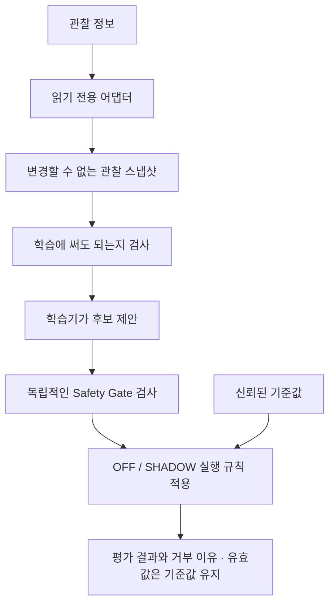

# CyberPilot AutoTune

**최종 목표: 당근(Carrot) 브랜치에 작은 PR 단위로 연결할 수 있는
조향·종방향 제어 오토튠 기능을 개발합니다.**

## 한국어 상세 소개

### 1. 이 프로젝트는 무엇을 만드는 건가요?

CyberPilot AutoTune의 최종 목표는 **당근(Carrot) 브랜치에 PR로 연결할
조향 및 종방향 제어 오토튠**입니다. 이 저장소에서는 그 기능을 구성할 학습·검증·연결
요소를 독립적으로 개발하고, 검토 가능한 작은 변경으로 나누어 통합할 준비를 합니다.

두 제어 방향을 먼저 구분해 보겠습니다.

| 방향 | 쉬운 설명 | 오토튠이 목표로 하는 일 |
| --- | --- | --- |
| 조향·횡방향 제어 | 원하는 경로를 따라 좌우로 움직이는 제어 | 관찰한 조향 반응을 바탕으로 제어 파라미터의 개선 후보를 계산·검증 |
| 종방향 제어 | 속도를 맞추기 위해 가속·감속하는 제어 | 관찰한 속도·가감속 반응을 바탕으로 제어 파라미터의 개선 후보를 계산·검증 |

여기서 목표로 하는 전체 기능과 지금 완성된 부분은 구분해야 합니다.
현재 구현은 공통 기반, SHADOW 평가, 조향 관련 관찰·잔차·토크 연구에 집중되어 있습니다.
종방향 전용 오토튠과 두 방향의 실제 Carrot 제어기 적용까지 모두 완성됐다는 뜻은 아닙니다.

제어기는 원하는 움직임과 실제 움직임을 비교하며 동작합니다. 예를 들어 원하는 방향으로
얼마나 돌고 있는지 관찰하면, 제어기의 설정을 연구하는 데 도움이 될 수 있습니다.
하지만 차이가 보인다고 해서 곧바로 설정을 바꾸어도 된다는 뜻은 아닙니다.
센서 오차, 시간 지연, 도로 기울기, 운전자 개입처럼 다른 원인도 섞일 수 있기 때문입니다.

그래서 이 프로젝트는 다음 질문을 차례대로 다룹니다.

1. 지금 들어온 정보는 믿고 계산에 써도 되는가?
2. 그 정보로 어떤 개선 후보를 제안할 수 있는가?
3. 후보가 정해진 소프트웨어 규칙을 만족하는가?
4. 계산 결과와 실제 실행 권한은 어떻게 분리해야 하는가?
5. 실제 사용을 검토하려면 어떤 추가 증거가 필요한가?

현재 핵심 라이브러리는 이 최종 목표로 가는 **연구·관찰 단계**입니다.
먼저 SHADOW에서 후보와 거부 이유를 검증하고, 대상 제어기의 계약과 통합 조건을 갖춘 뒤
Carrot용 변경을 단계별 PR로 검토하는 방향입니다.
현재 버전은 차량 설정을 자동으로 바꾸는 완성품이나 설치형 운전 보조 기능으로 제공하지 않습니다.

### 2. 먼저 이해하면 좋은 두 가지 모드

학생이 문제의 풀이를 연습하는 상황을 생각해 보겠습니다.
연습장에 답을 적는 일과 실제 장비의 설정을 바꾸는 일은 서로 다릅니다.
이 프로젝트의 SHADOW 모드는 그 연습장에 해당합니다.

| 모드 | 하는 일 | 실제로 사용되는 값 |
| --- | --- | --- |
| OFF | 학습과 후보 평가를 수행하지 않음 | 신뢰된 기준값 그대로 |
| SHADOW | 관찰값으로 후보를 계산하고 허용·거부 이유를 기록 | 신뢰된 기준값 그대로 |

여기서 **기준값(baseline)**은 엔진을 구성할 때 명시적으로 제공하는 신뢰된 값입니다.
학습기가 후보를 제안하거나 후보가 SHADOW 검사에 통과해도, 엔진의 실제 유효값은 기준값과
같습니다. 현재 차량에 값을 써 넣는 Apply 모드나 controller write 경로는 없습니다.

예를 들어 기준을 `B`, 학습기가 제안한 변화를 `Δ`라고 하면,
연구에서는 후보 `B + Δ`를 검토할 수 있지만 현재 엔진이 내보내는 유효값은 `B`입니다.
이 예시는 구조를 설명하는 기호이며 실제 차량의 튜닝 수치가 아닙니다.

### 3. 정보는 어떤 순서로 처리하나요?



각 단계의 역할을 나누는 이유는 한 부분의 판단을 다른 부분의 권한으로 착각하지 않기
위해서입니다. 학습기는 후보를 제안하고, Safety Gate는 별도로 검사하며,
실행 엔진은 현재 허용된 모드의 규칙을 지킵니다.

관찰값에는 속도, 원하는 곡률과 측정 곡률, 시간·순서, 운전자 개입, 제어기 포화 여부처럼
판단에 필요한 정보가 포함됩니다. **곡률**은 경로가 얼마나 휘어 있는지를 나타내는 값이고,
**포화**는 제어기가 낼 수 있는 출력의 한계에 도달한 상태를 뜻합니다.

정보가 너무 오래됐거나 순서가 뒤집혔거나 필수 신호가 없으면 학습에 사용하지 않습니다.
운전자 개입이나 포화가 있으면 그것도 배제 조건입니다.
화면의 활성 표시나 크루즈 설정만으로 실제 제어가 동작 중이라고 추정하지 않습니다.
모르는 값은 `None`으로 남기며, 편의상 정상적인 `0`이나 `False`로 바꾸지 않습니다.

### 4. 학습기는 무엇을 배우나요?

현재 잔차 통계 학습기는 원하는 움직임과 관찰한 움직임 사이의 차이, 즉 **잔차**를
제한된 범위의 통계로 요약합니다. 최근 정보에 더 무게를 두는 이동 통계를 사용하고,
명시적으로 정한 최소 표본 수와 조건이 만족될 때만 후보를 제안합니다.

여기서 중요한 점은 다음과 같습니다.

- 표본이 많다는 사실만으로 물리적으로 올바른 설정이 증명되지는 않습니다.
- confidence는 표본의 지지와 일관성을 요약한 지표이지, 안전 확률이나 운전 품질 점수가 아닙니다.
- 상황·기준값·관찰 시간의 연속성이 깨지면 학습 창을 다시 시작해야 합니다.
- 허용 범위, 변화량, 변화율, 최소 속도와 변환 계수는 호출자가 명시해야 합니다.
- 후보를 허용 범위에 억지로 맞추기 위해 잘라서 통과시키지 않습니다.

이는 “계산이 가능하다”와 “그 계산을 실제로 사용해도 된다”를 구분하기 위한 설계입니다.
상세 규칙은 [아키텍처](docs/architecture.md), [학습기 설계](docs/phase5_design.md),
[안전 계약](docs/safety_contract.md)에 정리되어 있습니다.

### 5. 실제 차량 없이 어떻게 검증하나요?

기본 검증에는 **합성 데이터**를 사용합니다. 합성 데이터란 실제 주행 기록 대신,
테스트 목적에 맞게 조건을 명확하게 구성한 예제입니다.
정상 입력뿐 아니라 잘못된 시간, 누락된 신호, 중복 관찰, 큰 이상값과 내부 오류도 넣어
기대한 이유로 거부하는지 확인합니다.

**리플레이(replay)**는 같은 입력과 설정을 다시 넣어 결과를 재현하는 장치입니다.
기준값 유지 여부와 거부 이유를 검사하고, 입력·설정·결과의 해시를 구분해 비교합니다.
해시는 내용이 달라졌는지 확인하는 데 도움이 되지만, 데이터의 진위나 차량 성능을
인증하는 수단은 아닙니다. 실행 시간 측정은 결정적인 결과 해시와 분리합니다.

| 검사 종류 | 확인하려는 것 |
| --- | --- |
| 단위·속성 검사 | 계산과 입력 규칙이 다양한 경우에도 유지되는지 |
| 통합 검사 | 여러 구성 요소를 연결했을 때 규칙이 유지되는지 |
| 아키텍처 검사 | 연구·관찰·실행 경계가 코드 의존성에서도 지켜지는지 |
| 고정 합성 리플레이 | 같은 입력에서 기대한 결과와 해시가 재현되는지 |
| 실패 주입 검사 | 오류나 불확실성이 생겼을 때 성공으로 오판하지 않는지 |

소프트웨어 테스트 통과는 실제 차량에서의 안전성·성능 향상을 입증한 결과와 구분합니다.
리플레이의 범위는 [검증 기준](docs/replay_acceptance.md)과
[입력·결과 규격](docs/replay_spec.md)을 참고하면 됩니다.

### 6. 토크·마찰 연구는 어떤 역할을 하나요?

별도의 오프라인 연구 코드는 관찰한 데이터로 토크 관련 계수와 마찰을 얼마나 구별해서
추정할 수 있는지 검토합니다. 여기서 **식별 가능성**은 “같은 관찰값을 설명하는 서로 다른
원인이 여러 개일 때, 우리가 원하는 원인을 정말 구분할 수 있는가?”라는 질문입니다.

예를 들어 관찰값의 흩어짐이 커졌다고 해 보겠습니다. 그 원인은 마찰일 수도 있지만,
센서 잡음이나 시간 정렬 오차일 수도 있습니다. 따라서 흩어짐을 나타내는 계수를 그대로
제어기의 실제 마찰값이라고 부를 수는 없습니다.

현재 연구는 이상적인 수학적 조건의 결과와 잡음·마찰이 섞인 조건의 한계를 분리합니다.
일부 실제 개발 데이터가 확보되지 않은 항목은 미검증 상태로 남겨 두었습니다.
이 연구 결과가 후보 생성이나 차량 적용 권한을 부여하지는 않습니다.
NumPy는 이 오프라인 분석을 위한 선택 의존성이고 핵심 라이브러리의 필수 의존성이 아닙니다.
자세한 결론은 [과학적 검증 결과와 한계](docs/torque_identification_qualification.md)에 있습니다.

### 7. 최종 목표인 Carrot PR에는 어떻게 연결하나요?

Carrot 통합은 이 프로젝트의 최종 목적입니다. 핵심 라이브러리를 openpilot에 의존하지 않는
독립 구조로 둔 이유도 계산·판정 규칙을 따로 검사하고, 대상 코드에 검토 가능한 작은 PR로
연결하기 위해서입니다.

예를 들어 공통 데이터 계약과 검사 규칙, 읽기 전용 신호 어댑터, SHADOW 연결,
조향·종방향 각각의 학습과 검증 근거를 나누어 검토할 수 있습니다.
정확한 PR 구성과 대상 branch/SHA는 통합 작업을 시작할 때 실제 Carrot 코드에 맞춰 고정합니다.

현재 Carrot 관련 코드는 필요한 메시지를 **읽기 전용으로 해석하는 별도 경계**에서 다룹니다.
메시지 형식뿐 아니라 정확한 원본·순서·시간 관계가 성립하는지 확인합니다.

현재 문서의 source audit와 합성 사례 검증은 특정 revision에 묶인 소프트웨어 근거입니다.
어댑터가 있다는 사실만으로 실시간 차량 연결, 학습 엔진과의 연결, 제어기 쓰기 또는
차량 설치까지 완료됐다고 해석하면 안 됩니다.
[신호 계약](docs/carrot_signal_contract.md),
[observation-v2 재검토](docs/carrot_observation_v2_reaudit.md),
[선택적 추출 경계](docs/carrot_phase8b_extraction.md)를 순서대로 읽으면 흐름을 이해할 수 있습니다.

### 8. 최근 진행한 Native E 연구는 무엇인가요?

별도 Native E 연구는 “프로그램을 시작했는가?”보다 더 엄격한 질문을 다룹니다.
**누가 이 실행을 만들었고, 지금도 원래 자원을 보유하고 있으며,
오류가 나면 무엇을 확실히 알 수 있는가?**를 검증하는 연구입니다.

이는 장래 별도 native worker를 사용하는 실행 경로의 신뢰성을 검토하기 위한 보조 연구입니다.
프로젝트의 최종 목표는 조향·종방향 오토튠의 Carrot 통합이며, Native E 자체가 그 목표를
대체하지 않습니다. 어떤 Native E 작업이 필요한지는 해당 오토튠 기능과 PR의 실행 구조에
따라 판단해야 하며, 모든 읽기 전용·SHADOW PR의 공통 선행 조건으로 간주하지 않습니다.

이 연구는 독립된 소스 이력과 전달 bundle에서 진행했습니다.
아래 로컬 연구 결과는 기본 브랜치의 라이브러리 CI 결과와 구분해야 하며,
해당 연구 구현 전체가 이 기본 브랜치에 통합됐다는 의미는 아닙니다.

두 가지 주요 구성 요소를 쉽게 설명하면 다음과 같습니다.

- **영속 intent:** 실행 전에 남기는 중복 시도 차단 기록입니다. 기록이 이미 있거나
  상태가 불명확하면 다시 실행하지 않습니다. 성공 영수증이나 재시작 허가증으로 쓰지 않습니다.
- **동적 manager 결합:** 현재 연결된 manager의 신원과 이번 생성 요청의 job을 연결해
  검사합니다. 예전 이름·숫자·결과 파일을 가져와 살아 있는 실행 권한을 복구하지 않습니다.

연구에서 사용하는 **FD**는 운영체제가 열린 파일·소켓 등을 가리키는 번호입니다.
번호가 같아도 다른 자원으로 재사용될 수 있으므로 번호나 파일 이름만 비교해서
“원래 내가 소유한 자원”이라고 판단하지 않습니다.
또한 `close`나 `wait`의 결과가 불명확하면 그것을 정리 성공으로 바꾸지 않습니다.

**2026-11-06 로컬 검증 보고 기준**, 연구 수정본
`7a3a2476b5a2fdc2696531038061aa7f97917c11`의 결합 suite는 다음과 같이 보고됐습니다.
전달받은 188개 case 목록은 해당 소스의 수집 결과와 정확히 대조했습니다.

| 분류 | PASS | FAIL / ERROR | SKIP |
| --- | ---: | ---: | ---: |
| native 결합 검사 | 91 | 0 / 0 | 0 |
| MODEL·기본 경로·컴파일·wrapper 회귀 | 92 | 0 / 0 | 5 |
| 전체 | 183 | 0 / 0 | 5 |

SKIP 5개는 MODEL에서 다룰 수 없는 kernel OFD 4개와 native clone 반환 1개입니다.
MODEL은 일부 동작을 명시적으로 모형화한 검사이며 실제 kernel 실행 근거와 구분합니다.
이전 37 FAIL과 이후 경로 준비 단계의 188 setup ERROR 기록도 별도로 보존했습니다.
이번 통과 결과로 과거 시도의 결과를 바꾸거나 테스트 수를 합산하지 않았습니다.

이 검사는 private synthetic manager와 고정 E probe의 결합을 다룹니다.
실제 시스템 manager 배포, 보호된 factory·code·loader, 다른 UID 사이의 격리,
실제 내부 작업 영역 전체의 수명주기나 차량 payload 실행 자격을 입증한 것은 아닙니다.
연구 상태는 `provider_registration=UNBOUND`, qualification `0/16`, 관련 flag 14개 `false`를
유지합니다. 별도 연구 snapshot의 기존 Python coverage도 47.71%로 90% gate 미달이며,
native 통과와 별개입니다. 이 수치를 기본 브랜치의 라이브러리 CI coverage로 옮겨 읽지 않습니다.

### 9. 앞으로는 어떤 순서로 진행하나요?

전체 프로젝트의 우선순위는 **조향·종방향 오토튠 기능을 정의하고 검증한 뒤,
Carrot에 작은 PR로 연결하는 것**입니다. Native E의 세부 실험 순서와 전체 기능의 로드맵을
구분해서 관리합니다.

| 권장 순서 | 다음에 확인할 내용 |
| --- | --- |
| 1 | 대상 Carrot branch/SHA와 조향·종방향 각각의 튜닝 대상, 필요한 신호·단위·허용 조건을 명시 |
| 2 | 이미 구현한 공통 계약·Safety Gate·SHADOW·리플레이 기반과 남은 요구사항을 대조 |
| 3 | 조향 관련 잔차·토크 연구를 실제 의미가 확인된 후보와 검증 근거로 연결; 미해결 식별 문제는 별도 해결 |
| 4 | 종방향 전용 관찰 계약·학습기·평가 지표·거부 조건을 설계하고 합성 검증부터 구현 |
| 5 | Carrot의 실제 신호를 읽기 전용으로 연결하고 SHADOW에서 기존 제어값을 유지하는지 검증 |
| 6 | 계약·어댑터·SHADOW·각 기능을 검토 가능한 작은 Carrot 대상 PR로 제안 |
| 7 | 실제 적용 기능은 별도 정책·차량별 검증·승인·복귀 조건을 갖춘 뒤 검토 |

별도 Native E 연구에는 원본 parent 전달·고정 worker·E가 만든 내부 작업 영역 D와의 결합,
보호된 코드 출처·외부 변경 배제(F1)·cross-UID 경계의 검증이 남아 있습니다.
실제 OS 실험과 qualification 16개 항목의 증거 확보도 그 연구 경로에서 따로 다룹니다.

parent는 상위 작업 범위, worker는 그 안에서 실행할 고정 작업 프로그램을 뜻합니다.
내부 작업 영역 D는 executor E가 직접 생성해야 한다는 별도의 요구가 있습니다.
같은 모양의 일반 디렉터리로 시험한 결과와 실제 cgroup에서 관찰한 결과는 구별해야 합니다.

위 순서는 연구 방향이며 관리자 변경이나 차량 실험에 대한 실행 승인이 아닙니다.
기존 Python coverage gate 해결도 별도 검토 과제로 남아 있습니다.
핵심 라이브러리의 과거 단계와 작은 upstream PR 방향은 [로드맵](docs/roadmap.md)에서 확인할 수 있습니다.
그 문서의 역사적 단계 번호와 최신 README의 연구 진행 요약은 구분해서 읽어 주세요.

### 10. 처음 살펴보는 사람은 어디서 시작하면 되나요?

먼저 합성 예제와 리플레이를 읽어 보는 것이 좋습니다.
차량 연결이나 관리자 권한 없이 핵심 라이브러리가 어떤 규칙으로 작동하는지 이해할 수 있습니다.
아래 명령은 **이 기본 브랜치의 Python 라이브러리**를 위한 개발 예시입니다.
별도 Native E bundle의 실행 절차는 해당 bundle의 인계 문서와 native 사전 조건을 따라야 합니다.

이미 설치된 Python `>=3.12.3,<3.13`으로 프로젝트 전용 가상환경을 사용합니다.
Windows에서는 가상환경 활성화 경로가 다릅니다.

```sh
python -m venv .venv
. .venv/bin/activate
python -m pip install -e ".[dev]"

# 합성 예제: 제안과 평가가 발생해도 기준값을 유지하는 흐름 살펴보기
python examples/residual_shadow.py

# 저장소에 포함된 합성 리플레이 근거 확인
python -m cyberpilot_autotune.replay.cli verify-all tests/fixtures/replay
```

전체 개발 검사와 build 절차는 아래 영문 기술 설명 및 [기여 안내](CONTRIBUTING.md)에 있습니다.
오프라인 수치 분석까지 수행할 때는 선택 의존성 `research`를 추가합니다.
실제 차량 튜닝값이나 실제 주행 로그를 위 합성 예제에 임의로 넣는 사용법은 제공하지 않습니다.

| 폴더 | 주된 역할 |
| --- | --- |
| `src/cyberpilot_autotune/contracts` | 관찰·후보·결과의 명시적 데이터 계약 |
| `core`, `safety`, `runtime` | 학습·검사·실행 규칙의 분리 |
| `adapters`, `integrations` | 외부 신호를 해석하는 선택적 경계 |
| `replay` | 합성 입력의 재현과 검증 |
| `research` | 실행·적용 경로와 분리된 오프라인 수치 연구 |
| `knowledge`, `owner_protocol` | 파라미터 지식의 계약과 소유권 프로토콜 연구 |
| `tests`, `examples`, `docs` | 검증 사례·합성 예제·설계 및 근거 문서 |

라이선스 선택은 아직 미정이며 LICENSE 파일은 제공하지 않습니다.
참고한 프로젝트나 소스가 있다는 사실이 이 저장소의 이용 허가를 대신하지 않습니다.

---

## English technical notes

Independent controller tuning research. This repository is in the research and
shadow-only stage. It has no production vehicle control or controller write path.

The purpose is a reusable, fail-closed, bounded online adaptation framework for
controller tuning research, developed independently for eventual small upstream
PRs. Current modes are OFF and SHADOW; effective values always equal baseline.

Architecture: observation source -> read-only adapter -> immutable snapshot ->
learning admission -> proposal-only learner -> candidate Safety Gate -> runtime
enforcer -> immutable result.
The core does not depend on openpilot. See [architecture](docs/architecture.md).

The historical [Phase 8A signal audit](docs/carrot_signal_contract.md) was blocked
at carrot-wip `604bc0a22733e648ec05b268da1ffaae7db52a69`. The new
[observation-v2 exact-head audit](docs/carrot_observation_v2_reaudit.md), pinned to
`c2130730239bcdb4cbde9361ab90c8d99aa4ff55`, proves the software signal contract
with a pure message-neutral evaluator and executable synthetic cases. Exact
receipt/source-command/source-CarState lookup, caller policy and immutable
static context/baseline are mandatory. Unknown inputs fail closed. This proves
neither physical response nor underlying planner quality. Phase 8B.1 adds an
[optional read-only extraction boundary](docs/carrot_phase8b_extraction.md) for
explicitly supplied generated readers, exact bounded caches and qualified
software sessions. It produces MappingDecision only. No live SubMaster loop,
Engine/learner connection or vehicle installation is implemented.

## Shadow residual learner

Phase 5 adds `ResidualStatisticsLearner` alongside `NoOpLearner`. It maintains
bounded EWMA curvature residual statistics for one context and returns proposals
only after explicit minimum sample requirements. Invalid, old, missing, override,
saturation and outlier evidence is excluded; context/baseline/gap/age transitions
restart the window. Optional learner reset is integrated with SHADOW rejection
paths. Before observe(), common admission requires explicit control_active=True,
speed at least the caller-supplied minimum_speed_mps, valid/fresh/ordered input,
trusted baseline identity and no override/saturation. None means activity is unknown;
cruise/UI enabled is never substituted. Actual Carrot activity mapping is absent.
OFF calls neither clock, admission, observe nor reset.

Both GateConfig and ResidualStatisticsConfig require an explicit finite nonnegative
minimum_speed_mps; no vehicle default exists. Common policy must be at least as
strict as the learner's declared minimum. reset() deletes the evidence window
only and preserves sequence/time high-water within the same monotonic stream.
A restarted sequence/time domain needs a new learner instance and engine.

Every scale, age, threshold and signed residual-to-parameter coefficient must be
supplied explicitly. There are no vehicle defaults. Confidence is a support and
consistency heuristic, not a calibrated probability or driving-quality measure.
SafetyGate still independently checks every candidate; effective values remain
exactly baseline. See [the Phase 5 design](docs/phase5_design.md) for formulas,
reset and numeric policies, and [progress](docs/phase5_progress.md) for evidence.

Run the local synthetic-only demonstration with:

```sh
python examples/residual_shadow.py
```

## Local development

Python >=3.12.3,<3.13 is required, based on inspected integration sources.
Use a local virtual environment (Windows activation path differs):

```sh
python -m venv .venv
. .venv/bin/activate
python -m pip install -e ".[dev]"
python -m ruff check .
python -m ruff format --check .
python -m mypy src/cyberpilot_autotune
python -m pytest -q
python -m pytest --cov=cyberpilot_autotune --cov-report=term-missing --cov-fail-under=90
python -m coverage report --include="*/safety/*" --fail-under=95
python -m coverage report --include="*/core/residual.py" --fail-under=95
python -m coverage report --include="*/replay/*" --fail-under=95
python -m pytest tests/integration/test_replay_golden.py -q
python -m cyberpilot_autotune.replay.cli verify-all tests/fixtures/replay
python -m build
```

`src/cyberpilot_autotune` contains contracts, safety, runtime, learners, adapter
interfaces, synthetic replay and in-memory diagnostics. `tests` contains unit, property,
integration and architecture tests. `examples` is synthetic only. `docs` records
the audit, safety contract, integration evidence and future roadmap.

No production safety or performance claim is made. There is no Apply mode,
controller write API, vehicle deployment, persistence, real log ingestion,
network telemetry or vehicle parameter registry. Python plugins are
trusted code; this is not a sandbox or a hard real-time implementation.

The source audit is pinned to CyberPilot commit
`588d6b21c21089065a7d9165d6e7a438e8aa6297`; the current branch HEAD was also
recorded separately in the [inventory](docs/porting_inventory.md). No code was
copied from that source. Remaining phases are recorded in
[the roadmap](docs/roadmap.md). Persistence is NOT_AUTHORIZED; synthetic software
acceptance does not authorize learner state storage or real replay data.

License selection is pending. No LICENSE file is provided. Source references do
not establish a license for this independent repository.

## Offline torque identification research

H5 separates scientific estimands from raw numerical parity and from the H4 owner
protocol. Use `python -m pip install -e ".[dev,research]"` for the optional NumPy
analysis dependency. Importing the package without that extra remains supported;
executing a fit requires it. The research package has no runtime/application path.

See [qualification and limitations](docs/torque_identification_qualification.md).
Native spread is not directly identified controller friction. The specified
frozen development artifact was not located, so real route/epoch statistics are
unavailable; historical counts are not promoted to recomputed evidence. Neither
synthetic success nor a scientific report authorizes candidates or vehicle use.

## Deterministic synthetic replay

`cyberpilot_autotune.replay.load_replay(json_string)` validates a bounded synthetic
schema before execution. `run_replay(scenario)` constructs fresh OFF and SHADOW
engines and returns immutable traces, counts, independent invariant checks and a
SHA-256 digest binding the inputs, policy and deterministic results. Runtime
latency is measured separately and excluded from the digest. The library reads
and writes no files. The caller explicitly supplies any document string.

Run the small checked-in synthetic golden fixture locally:

```sh
python -m cyberpilot_autotune.replay.cli run tests/fixtures/replay/constant_residual_v1.json
python -m cyberpilot_autotune.replay.cli verify-all tests/fixtures/replay
```

Only cli.py reads explicit local fixture files; core APIs remain free of file IO.
The example delegates its aggregate fixture to this CLI. run emits canonical JSON
without latency; verify checks digests, counts/reasons and focused event evidence.
scenario_sha256, configuration_sha256 and result_sha256 identify separate domains;
digest remains the result alias. Repeated/regressed observations reach the unchanged
engine; evaluation clocks remain monotonic. Both modes retain baseline. See the
[schema and encoding](docs/replay_spec.md) and
[software acceptance criteria](docs/replay_acceptance.md). A matching digest is
regression evidence, not data authentication or vehicle performance evidence.
Ordering policy and its availability tradeoff are characterized in
[the ordering evidence](docs/replay_ordering.md).
