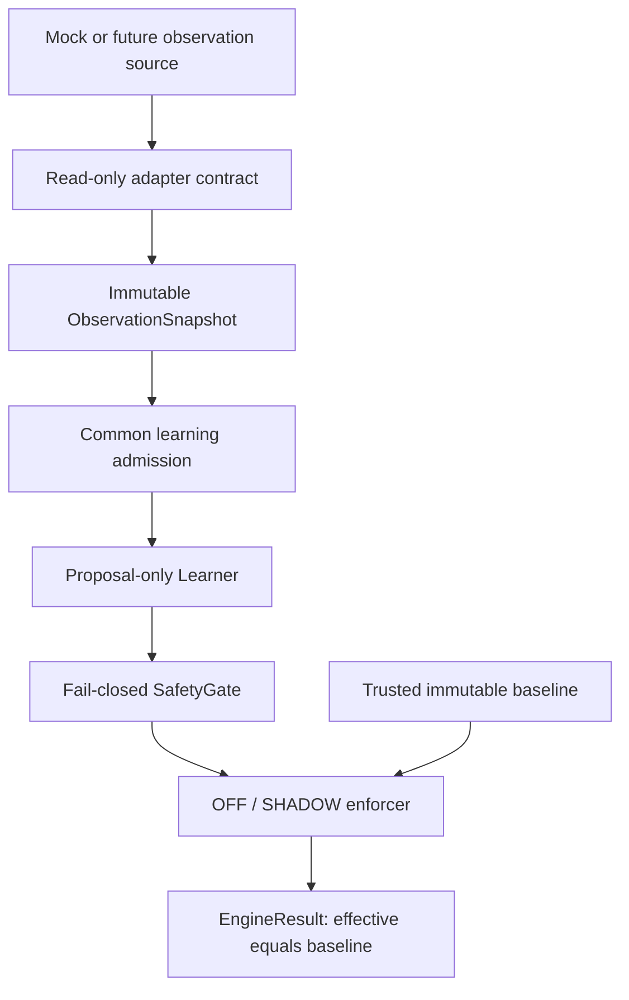

# Architecture

This is a research library, not a vehicle control system. The user-supplied
Phase 0-4 specification and subsequently approved Phase 5 learner are the
implementation authority, with the user's subsequent admission hardening request.
See phase5_design.md and admission_hardening.md for the current contracts.

Contracts use frozen dataclasses, defensive tuple copies and immutable mappings.
Constructors reject invalid types, booleans masquerading as numbers, non-finite
values and invalid ranges with a typed ValidationError. Missing optional signals
are None; missing required gate signals veto eligibility.

SafetyGate is a stateless evaluator with an immutable registry and explicit
configuration. The engine owns a single stream's high-water sequence, observation
time and evaluation time. It admits an observation before invoking the learner.
Invalid, stale, reordered, inactive, below-minimum-speed, overridden or saturated
observations never reach the learner. Rejected valid sequences also consume
sequence high-water. Only clock-safe finite nonnegative timestamps advance time
high-water, so future timestamps cannot poison normal stream time. Current-frame
checks retain the previous cursor. A new engine starts a new stream lifecycle.

The engine is configured with a trusted baseline; untrusted snapshots cannot
replace that fallback. It has no controller reference, callbacks, external sinks,
network, threads or persistence. OFF does not read the clock or change stream
state. SHADOW records proposals and decisions in memory only. Every result is
constructed with the same immutable baseline as its effective mapping.

The gate checks each proposed delta against the baseline. Its rate budget is
maximum_rate_per_second times the interval since the preceding clock-safe frame.
Admission-rejected frames can conservatively shorten that interval.
On the first frame only an unchanged candidate has a known zero rate. This is a
conservative shadow screening rule, not a future application rate policy.

Only the engine's outer processing boundary catches unexpected Exception. It
discards partial proposals/decisions, emits INTERNAL_ERROR and preserves baseline.
Constructor/configuration errors remain visible. Diagnostics contain exception
type only, never exception messages, tracebacks, raw inputs or source identities.
SystemExit and KeyboardInterrupt remain process-level signals.

Alternatives considered: copying the existing offline experiment suite would
retain native controller/process dependencies; embedding this in controlsd would
prevent independent validation. The selected standard-library core makes future
small upstream PRs possible. It is single-owner, synchronous and not a real-time
or hostile-plugin sandbox. A learner that hangs cannot be preempted here; no hard
deadline guarantee is claimed.

Phase 5 adds one bounded, context-aware residual-statistics learner. It receives
an explicit target specification and conversion policy, retains no raw history,
and emits only proposals. The optional ResettableLearner lifecycle clears evidence
when SHADOW rejects an observation before or after learner work. Existing stateless
learners need only observe(). OFF invokes neither lifecycle method nor clock or
admission. A faulted engine cannot resume; a replacement in the same monotonic
stream may use a reset learner, while a restarted sequence/time domain requires
a new learner instance. Each engine
owns its learner exclusively. Persistence and external data ingestion remain absent.
