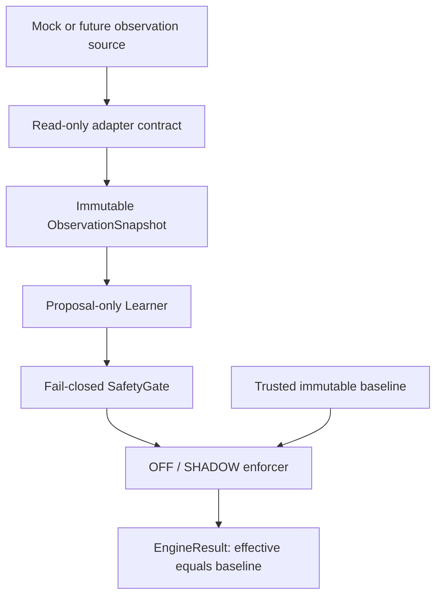

# Architecture

This is a research library, not a vehicle control system. The user-supplied
Phase 0-4 specification is the implementation authority.

Contracts use frozen dataclasses, defensive tuple copies and immutable mappings.
Constructors reject invalid types, booleans masquerading as numbers, non-finite
values and invalid ranges with a typed ValidationError. Missing optional signals
are None; missing required gate signals veto eligibility.

SafetyGate is a stateless evaluator with an immutable registry and explicit
configuration. The engine owns a single stream's high-water sequence, observation
time and evaluation time. It admits an observation before invoking the learner.
Invalid, stale or reordered observations never reach the learner. Admitted frames
consume their sequence even if a learner fails. A new engine resets this state.

The engine is configured with a trusted baseline; untrusted snapshots cannot
replace that fallback. It has no controller reference, callbacks, external sinks,
network, threads or persistence. OFF does not read the clock or change stream
state. SHADOW records proposals and decisions in memory only. Every result is
constructed with the same immutable baseline as its effective mapping.

The gate checks each proposed delta against the baseline. Its rate budget is
maximum_rate_per_second times the interval since the preceding admitted frame.
On the first frame only an unchanged candidate has a known zero rate. This is a
conservative shadow screening rule, not a future application rate policy.

Only the engine's outer processing boundary catches unexpected Exception. It
discards partial proposals/decisions, emits INTERNAL_ERROR and preserves baseline.
Constructor/configuration errors remain visible. Diagnostics contain exception
type only, never exception messages, tracebacks, raw inputs or source identities.
SystemExit and KeyboardInterrupt remain process-level signals.

Alternatives considered: copying the existing offline experiment suite would
retain native controller/process dependencies; embedding this in controlsd would
prevent independent validation. The selected standard-library core makes future
small upstream PRs possible. It is single-owner, synchronous and not a real-time
or hostile-plugin sandbox. A learner that hangs cannot be preempted here; no hard
deadline guarantee is claimed.
