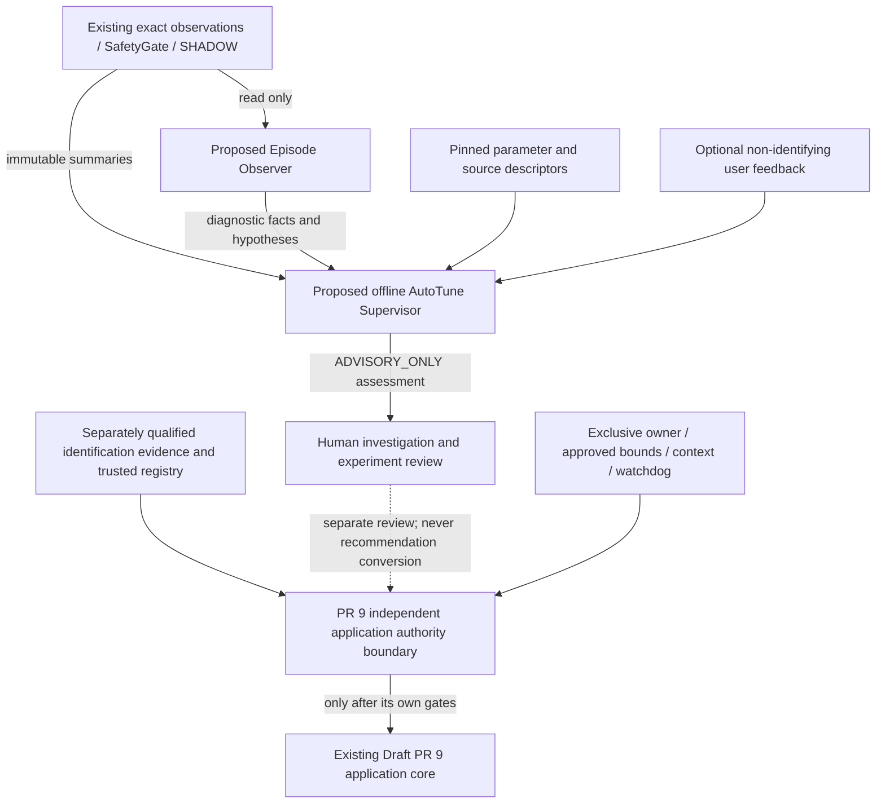

# Proposed offline advisory AutoTune Supervisor

Status: **AUTOTUNE_SUPERVISOR_DESIGN_READY** as a design proposal, not an implemented
backend. External AI: **NOT_AUTHORIZED**. No supervisor/AI client/application bridge
is added in H1. The owner must separately authorize any development.

## Decision and alternatives

Recommend a deterministic offline advisory layer after a read-only observer and
source/parameter knowledge contracts. It summarizes evidence gaps and experiments,
not tuning authority. Hoya's readable explanations and parameter/source context
are useful concepts; its fixed numerical recommender, fallback targets and direct
Apply chain are unsuitable (A:rules/A:parse/H:apply in the
[audit evidence index](hoya_c3_atune_audit.md#evidence-index)).

Alternatives rejected/deferred: putting an LLM inside the controller/learner or
grant issuer is rejected; external providers are deferred pending separate privacy,
network and operational review. A built-in keyword engine producing preset target
numbers is not independent parameter identification.

## Architecture and authority boundary

There is **no** edge from Supervisor/episode output to SteeringRequest,
AuthorizationGrant, owner lease, target commit, engine or learner. The dashed
human review cannot mint missing evidence or bypass PR #9's real writer gates.
No concrete production authorizer/writer currently exists. PR #8 remains Draft
with actual parked qualification pending and runtime fingerprint UNCONFIRMED.

## Input contracts (proposed, not new runtime classes)

| Input | Required semantics |
|---|---|
| EpisodeSummary | Immutable observed facts versus hypotheses, heuristic/policy versions, exact cohort/coverage/gap references |
| ShadowProposalSummary | Research-only proposals, context/evidence/sample provenance and explicit rejection/eligibility counts; not performance proof |
| GateDecisionSummary | Original reason counts/version and observation identities; no rescreening or override of veto |
| ParameterDescriptor | Name/family, semantic description, canonical unit and storage scaling, actual consumer/mode, source revision/hash, UI default/range, observed current-value provenance if separately supplied, descriptive ownership |
| SourceKnowledgeDescriptor | Repository, exact SHA, path, symbol/range, blob and source/range hashes, semantic claim, conditions, confidence and schema revision |
| OptionalUserFeedback | Explicitly optional user-reported symptom/time scope, provenance and uncertainty, sanitized/non-identifying text |

ParameterDescriptor fields describe software semantics. Missing values remain
unavailable; UI defaults do not fill current values or baselines. Unit/scaling
conflicts (such as Hoya Kf/Ki labels) must appear as evidence gaps. Custom torque,
torqued, NN/brand modes and MEB/custom steer ratio branches are explicit conditions.
An ownership description is not a lease or proof of exclusive ownership.

ApplicationParameterPolicy remains a separate PR #9 caller responsibility: approved
registry/units, hard bounds, step/rate, qualified evidence requirement, independent
authority, owner identity/revision, baseline epoch, rollback and watchdog. Neither
UI min/max nor source's current clamp range supplies these approvals.

Descriptors need no raw copied control bodies. Pin structured claims, hashes,
source links and limiting conditions. A source change invalidates the affected
claim until re-audited. Runtime attestation/source context must not be inferred
from a branch name. Source grounding reduces unsupported explanations, not the
need for qualification or review.

## SupervisorAssessment output proposal

Always **ADVISORY_ONLY**, containing only:

- Observations with immutable evidence/cohort references and quality/coverage limits.
- Possible root-cause hypotheses, explicitly unproven and compatible alternatives.
- Evidence gaps, contradictions, unresolved units/ownership/inputs and abstentions.
- Parameter **families to inspect**, not numerical values to write.
- A suggested next experiment, with purpose, required evidence and independently
  reviewed acceptance criteria; it does not initiate collection, replay or a run.

It contains no apply request, target numerical write, SteeringRequest, grant,
lease, safety approval or vehicle-ready conclusion. A confidence score, count,
digest, good explanation or human preference never grants these capabilities.
No suggested experiment starts automatically.

## Determinism, causality and privacy

Initial proposed backend is deterministic/offline only, with explicit rules/version,
stable ordering, bounded input/output and abstention on unknown/conflicting facts.
Summary templates must say "possible" or "insufficient evidence" where appropriate.
An intervention event cannot establish dissatisfaction; optional feedback records
what was reported, while traffic, obstacles, positioning, navigation and ordinary
takeover remain possible explanations. Correlation is not parameter identification.

Inputs are read-only copies. No learner mutation, Params, controller, file/log
storage, database, sockets, background work, provider SDK or network capability.
No persistence by default; H1 authorizes none. User text/source claims are untrusted
data and cannot change policy, request tools, select arbitrary endpoints or promote
an assessment to authority.

Future external AI would require new approval plus explicit field allowlists,
redaction, retention/credential policies and source-bound output validation. VIN,
route, GPS, raw log/CAN, device identifier and driver identity are prohibited.
Hoya's route/current-Params/complaint prompt and browser/device credential storage
are not a privacy template. Custom localhost-looking URLs do not prove locality.
No provider request or credential access occurs in this audit.

## Acceptance plan for separately approved implementation

- Stable normalized inputs yield identical assessments; missing/contradictory
  evidence produces abstention, never fabricated targets or baseline values.
- Facts and hypotheses stay distinct under override, unavailable source and user
  feedback changes; causal certainty requires independently defined evidence.
- Descriptor revision/hash/unit/mode mismatch blocks affected interpretations;
  UI range mutation never changes an application policy or admissible parameter.
- Recommendations cannot be converted into SteeringRequest/AuthorizationGrant;
  architecture/type/capability tests cover both direct and indirect paths.
- Privacy schema rejects prohibited fields; free text cannot invoke tools, network,
  filesystem or alter output authority. No external provider installed by default.
- Existing snapshots, gate results, learner state, parameters and replay goldens
  remain identical with/without advisory assessment. Synthetic inputs only.

These tests are future design acceptance criteria; H1 validates documents/manifests
and unchanged existing code, not a functioning supervisor. Longitudinal taxonomy
remains FUTURE_LONGITUDINAL_EPISODE/UNRESOLVED_INPUT and is not a control expansion.
