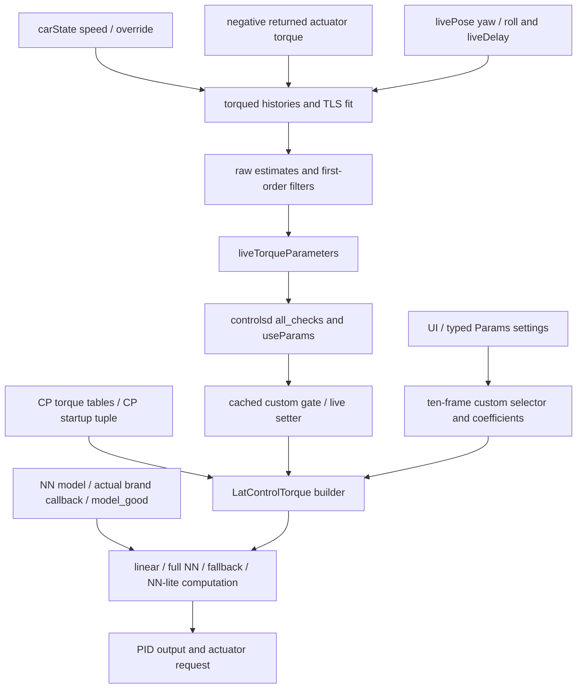

# Pinned steering producer/consumer graph

Scope: H3 read-only source audit. R = runtime
`c2130730239bcdb4cbde9361ab90c8d99aa4ff55`; C = current carrot-wip
`f5e4f8b8a1589e908811c751ea0a2ab2218bd4a3`. Integration
`7a2f051b1f3847786318900444c88c2ba7a74a67` has R's exact tree.
Both source graphs below were independently inspected. No process was launched.
Evidence IDs below have `runtime:` / `current:` prefixes in
[the manifest](evidence/carrot_writer_ownership_sources.json).

## Edge contract

| Source → target | Fields and cadence | Condition / priority / override / fallback | Evidence suffix |
|---|---|---|---|
| CP tables → CP tuning → controller | factor/friction, CP offset; construction | Selected torque tuning; captures defaults, not a trusted current baseline | torque-tables, cp-seed, controller-init |
| carControl/carOutput/carState/livePose/liveDelay → estimator | activity, negative returned normalized torque, speed, override, yaw/roll/lag; poll livePose, nominal 20 Hz | all_checks; histories interpolate independent source timestamps, not receipt exact join; fit gates require sustained activity/no override/source thresholds | sample-inputs, estimator-main, services |
| samples → fit | TLS slope/intercept and perpendicular spread | Calculable and valid buckets differ; error/reset behavior retains separate filtered state | fit, buckets, reset |
| fit → filters → message | Raw/Filtered factor, offset, frictionCoefficient; nominal 4 Hz | Clip factor/friction against CP-relative estimator heuristics; offset is not clipped here. liveValid is separate from Event valid. Filter loop is not an owner transaction | publish, filter-update, first-order |
| live message → controlsd | Three Filtered fields from one latest SubMaster message; every state_control | all_checks/useParams, **no updated requirement and no liveValid check here**. Can repeatedly forward the same filtered tuple | controlsd-frame, health |
| controlsd → live setter → builder | factor, offset, friction, assigned in that order | Cached custom >0 suppresses the call's assignments. No expected revision, ack, owner lease or readback | live-setter |
| UI → Params → controller | selector get_int; coefficients get_float with .001 or .01 scales | Per-key storage; reads every ten controller frames. Fresh selector may override the earlier live setter in the same calculation | settings-write, params-put, controller-compute |
| builder → controller computation | factor/friction/offset stored; effect varies by callback | Active calculation and actual callback/model mode matter. Offset is not directly read by the inspected base/GM torque equations | controller-compute, default-linear, gm-neural, gm-siglin |
| NN flags/model → computation | Cached full-NN/NN-lite flags, model inputs; per-call model_good | Full NN with good model bypasses base factor division, optional friction override calls callback. Missing model takes callback fallback; NN-lite modifies error/friction shaping | callback-init, controller-compute |
| controller → telemetry | PID/acceleration/actuator evidence, nominal 100 Hz | No coherent effective parameter tuple/revision acknowledgement is published | controlsd-publish, controlsd-loop, schema |
| estimator → persisted reference cache | LiveTorqueParameters bytes every 240 frames, nominal 60 s | Existing upstream persistence only, **not executed/added by H3**; restore key is not an application baseline epoch | estimator-main, restore-key |

Cadences are source declarations, not measured timing guarantees. A SubMaster
frame is a local loop counter, not a commit revision or source sequence.

## Same-frame order and mode transitions

The inspected loop calls update → state_control → publish. Within state_control:
VM update/calculation → live setter → engagement/readiness gates and command
construction → desired target → LaC.update. The custom sampler is at the start
of LaC.update, before its active/inactive branch. Thus sampling may happen even
when no active torque output is calculated.

- Cached custom 0, newly sampled positive: live tuple may be assigned first,
  then manual factor/friction and captured CP offset replace it in that call.
- Cached positive custom: live setter is suppressed, but torqued continues its
  independent onroad process/publication. A message is not effective truth.
- Custom 1 → 0: the source's reset condition is previous mode **>1**, so it does
  not reset that tuple at this sampler. The next eligible live setter can replace
  it; if health/useParams fails, old controller state can remain.
- Previous mode >1 → 0: source resets to captured defaults at sampling, then a
  subsequent eligible live setter can replace it. UI max 1 does not prove other
  stored values impossible. No change to this existing behavior is proposed here.

Changing custom mode or actual callback/NN context during a hypothetical owned
application must invalidate that ownership session; it cannot silently transfer
the baseline/lease. `WRITER_MODE_UNSUPPORTED_NN` and
`WRITER_MODE_CONTEXT_CHANGED` are proposed rejection labels only.

## No current owner guarantee

The controller builder is the closest numeric consumer state in the scoped base
path, but it has no public owner-snapshot protocol. A single live message is
coherent publication data; sequential field assignments in a serialized call
are observable source order. Neither constitutes PR #9 atomic tuple CAS with
revision, identity, independent readback and failure semantics. The Python GIL
is not used as a semantic transaction proof.
