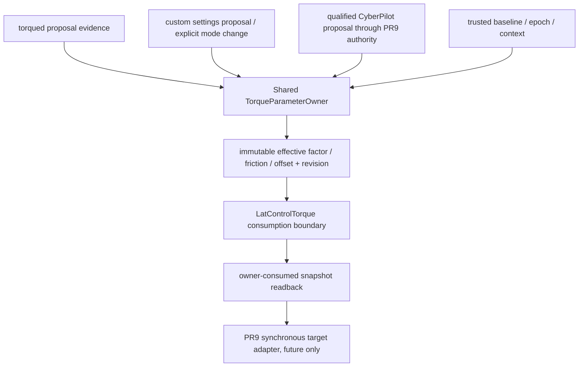

# Proposed torque parameter ownership architecture

Status: **Proposed design direction, not an approved executable owner design**.
H3 selects exactly one model, C: SHARED_TORQUE_PARAMETER_OWNER, located in the
serialized controlsd execution domain. No class, RPC bridge or writer is built.

## Alternatives and scores

Scores are 0–5 conditional architecture potential, higher is better, including
lower latency. They describe what a reviewed source change could offer, not
what current Carrot supplies. Numerical scores are not safety evidence.

| Axis | A direct attributes | B torqued owner | C shared owner | D controlsd monolith | E Params |
|---|---:|---:|---:|---:|---:|
| Exclusive ownership | 0 | 3 | 5 | 4 | 0 |
| CAS feasibility | 0 | 3 | 5 | 4 | 0 |
| Tuple coherence | 1 | 3 | 5 | 4 | 0 |
| Readback | 1 | 2 | 4 | 4 | 0 |
| Rollback | 1 | 2 | 4 | 3 | 1 |
| Watchdog | 0 | 1 | 2 | 2 | 0 |
| Latency | 5 | 1 | 4 | 5 | 1 |
| Compatibility / migration | 2 | 2 | 2 | 3 | 3 |
| Upstream friendliness | 1 | 2 | 3 | 3 | 1 |
| torqued responsibility preserved | 1 | 2 | 5 | 4 | 1 |
| Custom/NN handling | 0 | 2 | 4 | 3 | 1 |
| Failure isolation | 0 | 3 | 4 | 2 | 0 |

- **A rejected:** existing setters/custom sampler remain competing effective
  writers; exposing attributes supplies neither CAS nor independent readback.
- **B not selected:** the estimator does not own the actual controller consume
  point. Moving owner authority there requires a new cross-process revision/ack
  protocol and mixes scientific fit work with transactional application duties.
- **C selected:** one small owner boundary receives proposals and exposes the
  actual consumed tuple/revision; scientific estimator work remains separate.
  Migration costs and frozen-process recovery remain substantial/unresolved.
- **D not selected:** can serialize at the correct control boundary, but combines
  arbitration, transaction policy and controller computation in a larger unit,
  making independent tests/fault isolation harder. C uses that execution domain
  with a separate ownership responsibility.
- **E rejected:** per-key persistent storage is not current effective tuple
  truth, CAS, coherent rollback or watchdog. Persistence is outside this scope.

Evidence: runtime/current live-setter, controller-compute, controlsd-frame,
estimator-main, params-put, schema and pr9:ports/coordinator. The current gaps,
not the score total, determine the selection. No upstream adoption is assumed.

## Selected conceptual flow

The hypothetical CyberPilot edge does not connect the current learner or sidecar.
Independent qualified evidence and authority are prerequisites, not produced by
the owner or this audit. No descriptor/recommendation becomes a request or grant.

## Required properties for detailed design

1. Exactly one effective writer, serialized at a named boundary before one
   controller calculation. All estimator/custom/default update paths must route
   through it; a parallel setter or alias to the old mutable builder is forbidden.
2. One immutable factor/friction/offset tuple with exact supported numeric/wire
   representation, source/controller/callback/NN/custom/VM context and owner
   instance/epoch. Offset and unrelated gains/limits are preserved.
3. Every effective transition, including mode/reset/recovery, has a monotonic
   revision. expected_revision comparison and selected-tuple replacement are one
   owner operation; exact +1 ack only after completion. No GIL-based proof.
4. Post-ack snapshot reads the **actual consumed** tuple/revision, not request
   echo, estimator output or a stale candidate. Float32 round-trip semantics must
   be approved before authorization; no silent target-side rounding/clamping.
5. Trusted baseline is independent caller evidence captured coherently under the
   admitted owner context; defaults/cache/latest messages cannot substitute.
   Recovery CAS and exact readback apply only while the revision is still owned.
6. Bounded ingress, reject/unknown/timeout/foreign-ownership outcomes, explicit
   hold/release priority and no hidden retries/rearming. No disk IO/Params/network
   or unbounded fit work in the owner consumption boundary. This is a requirement,
   not an implemented lock-free or real-time guarantee.
7. Keep torqued as a scientific proposal producer, including its source health
   and estimate validity; decide explicitly whether proposals are held/rejected
   during a CyberPilot lease. Do not claim source gating or estimator suspension
   already exists. Custom changes invalidate the lease. Unqualified NN/brand
   paths remain unsupported until separately specified.
8. Normal owner-loop watchdog checks source/veto/hold state before consumption.
   A separately assigned liveness/recovery executor must address process stalls;
   a blocked owner cannot execute its own rollback. No verified restoration may
   be claimed without a scheduled owner/readback. Approved failure/restart/session
   behavior is still **BLOCKED**, not solved by selecting this architecture.

## Approval and implementation gates

CAS/readback/rollback/watchdog details are not approved in H3. Global factor and
friction equivalence, caller unit registry and independent identification remain
blocked; current source has no owner protocol. Runtime source selection/fingerprint
and vehicle bounds/rates remain separate gates. A new synchronous SteeringTarget
adapter cannot be implemented by merely attaching a lock to the old setter or
by calling an asynchronous publication a successful synchronous commit.

The single recommended next task is **Shared TorqueParameterOwner detailed
design**: specify consume/ack/readback, unit/representation admission, arbitration
and liveness responsibilities while retaining all unresolved activation vetoes.
This is a recommendation only; no next task or source modification starts here.
